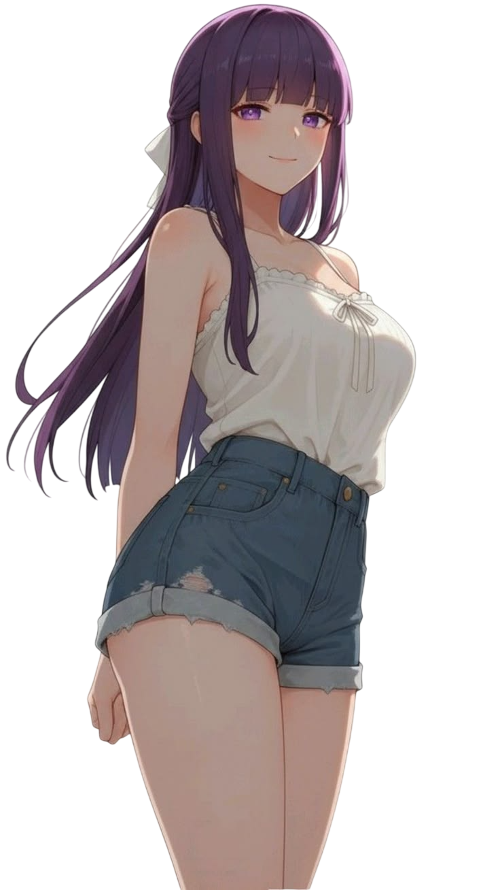
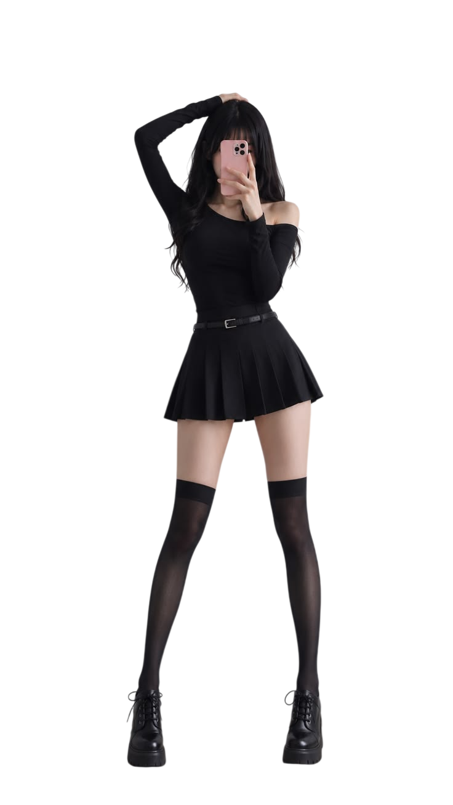
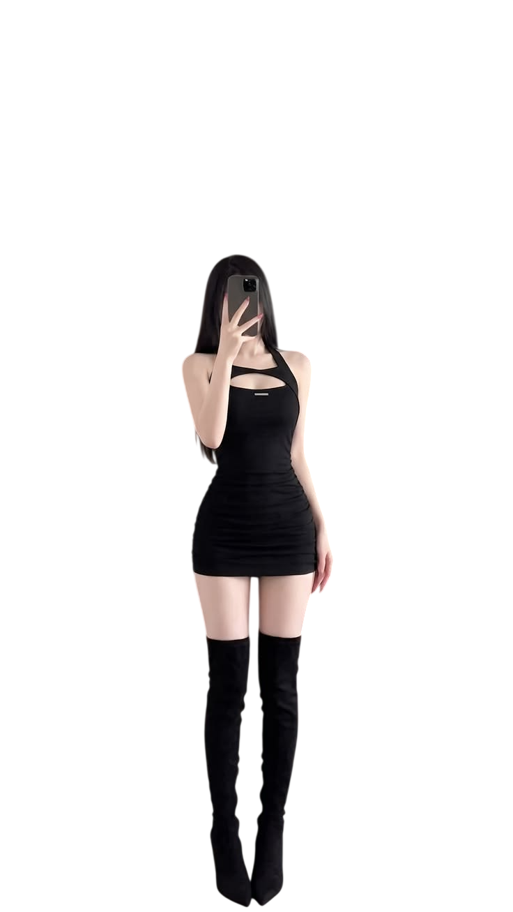

  

  

  
  
  

  

⛓ ━━━━━━━━━━━━━━━━ ✝ ━━━━━━━━━━━━━━━━ ⛓

<!-- 🖼 ФОТО 1 — справа от приветствия -->

## 🖤 Hi there

- ⛓ I'm a **Middle Cross-Platform Mobile Developer**
- ✝ I build apps for **Android** and **iOS** from a shared codebase
- 🕸 Always enjoying clean code and cool architecture
- 🥀 Always open to cool projects & collabs

 

<!-- 🖼 ФОТО 2, 3, 4 — галерея в ряд -->

  
  
  

⛓ ━━━━━━━━━━━━━━━━ ✝ ━━━━━━━━━━━━━━━━ ⛓

## ✝ Featured Projects & Works

###  Kotlin Multiplatform
* **Proctoring System SB Test** — A proctoring system for online testing and examinations.
* **CRM System Baiel** — A CRM system designed to automate business workflows.

###  Flutter
* **Baytur Issyk-Kul** — A mobile application for a resort hotel and spa complex on Lake Issyk-Kul.
* **Baytur Suusamyr** — An app for a mountain ski resort and traditional kumis health retreat in Suusamyr.
* **Green bonus** — An eco-friendly application aimed at collecting and recycling plastic waste.

###  React Native
* **Sinteza** — An all-in-one AI generator web service platform (video, image, voice generation).
* **SB Menu** — A digital ecosystem and app built for restaurants and the food service industry.
* **Beiman Wear** — A modern branded clothing online store.

###  JavaScript
* **Asman Tourism** — A tourism website designed for travel discovery and bookings.

⛓ ━━━━━━━━━━━━━━━━ ✝ ━━━━━━━━━━━━━━━━ ⛓

## ⛓ Tech stack

  

<!-- 🖼 ФОТО 5, 6, 7 — галерея в ряд -->

  
  
  

⛓ ━━━━━━━━━━━━━━━━ ✝ ━━━━━━━━━━━━━━━━ ⛓

## 🕸 GitHub stats

<!-- 🖼 ФОТО 8 и 9 — по бокам от статистики -->

  
  
  

⛓ ━━━━━━━━━━━━━━━━ ✝ ━━━━━━━━━━━━━━━━ ⛓

<!-- 🖼 ФОТО 10 и 11 — по бокам от прощальной надписи -->

  
  &nbsp;&nbsp;
  
  &nbsp;&nbsp;
  

  

