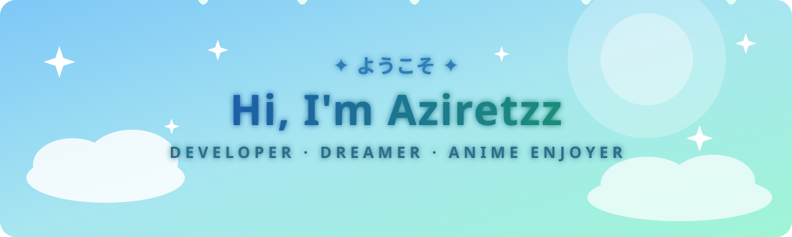

<p align="center">
  
</p>

<p align="center">
  <a href="https://git.io/typing-svg">
    
  </a>
</p>

<p align="center">
  
</p>

---

## 🌸 About me ⋆｡˚

```yaml
name: Aziretzz
vibe: "🌸 anime  ✦  🎧 k-pop  ✦  💻 code"
stack: [ "Kotlin Multiplatform", "Flutter", "React Native" ]
focus: "cross-platform mobile apps 📱"
favorite_music: [ "BABYMONSTER", "K-pop" ]
goal: "build cool things & grow every day"
fun_fact: "I debug better at 3am ✦"
```

## 💫 Tech stack

<p align="center">
  
  
  
  
  
  
</p>

## 🫧 GitHub stats

<p align="center">
  
</p>

<p align="center">
  
</p>

<p align="center">
  
</p>
