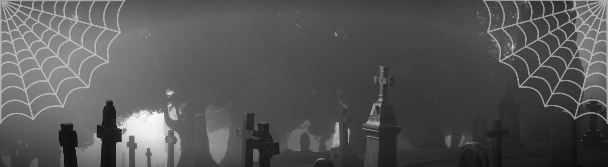
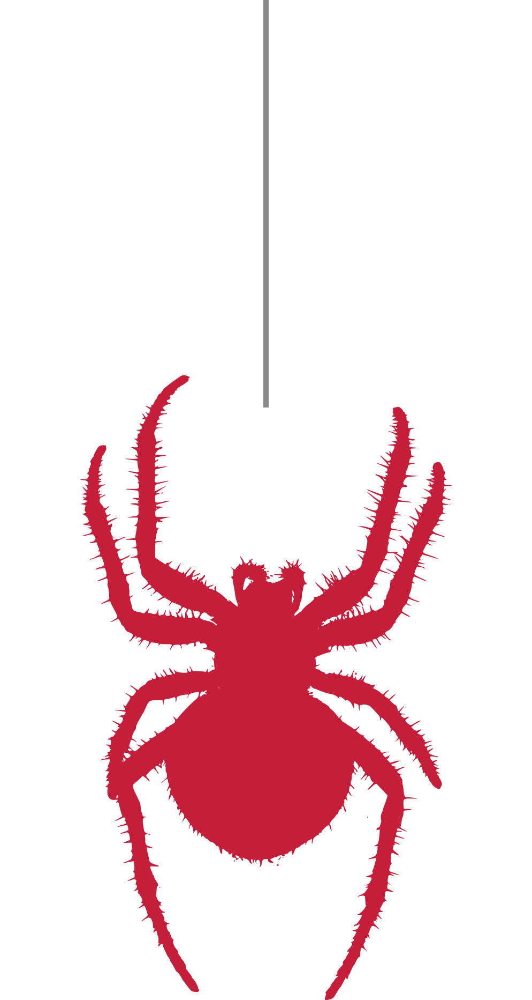
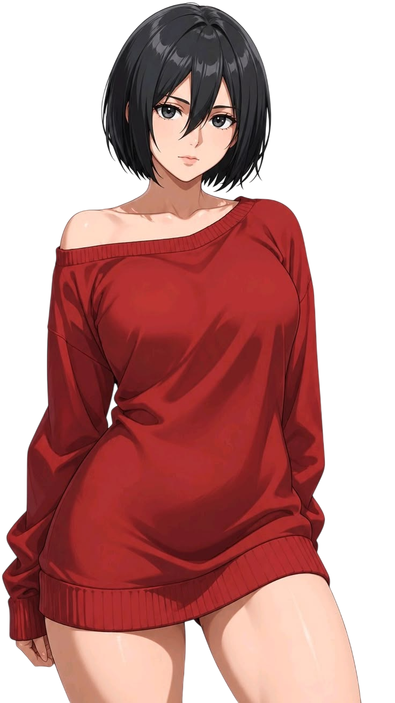
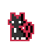
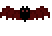
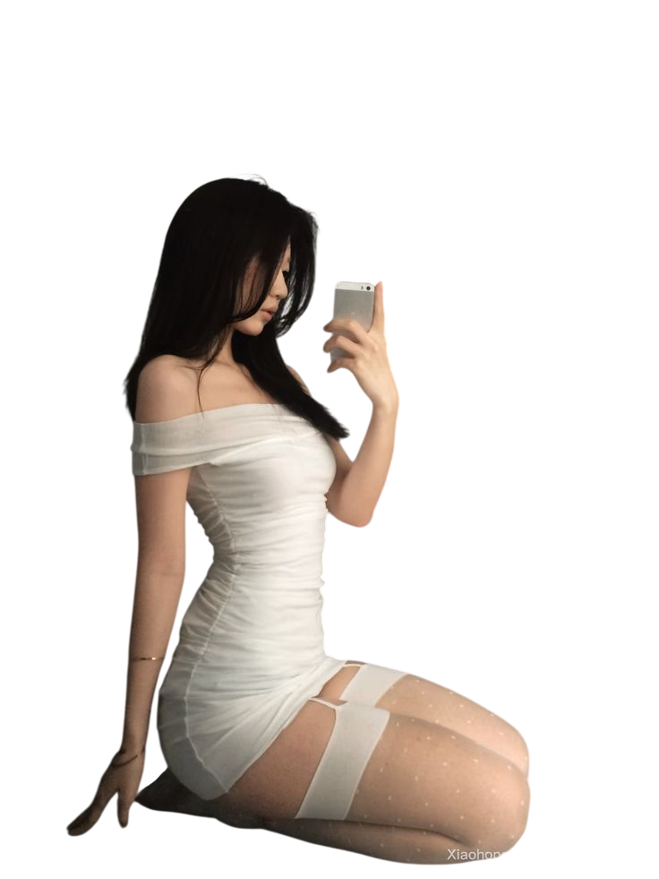
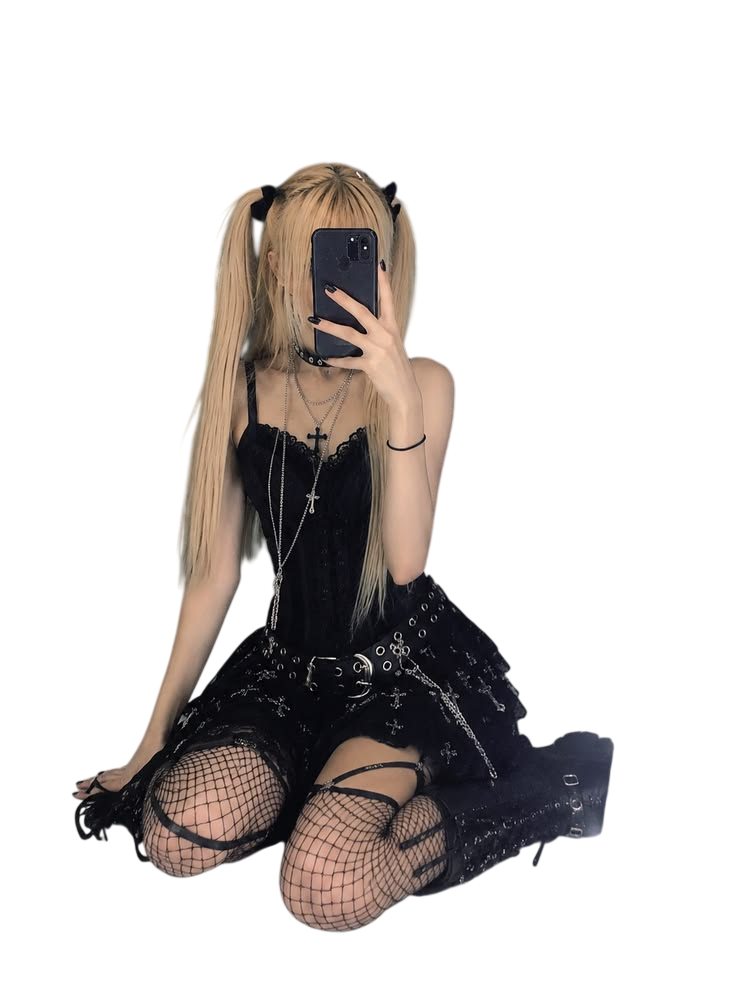

  

<!-- 🕸 Аватар с декорацией -->

  

  

  
  
  

  

##  Hi there

-  I'm a **Middle Cross-Platform Developer**
-  I work with **Kotlin Multiplatform**, **Flutter** and **React Native**
-  Always enjoying clean code and cool architecture
-  Always open to cool projects & collabs

  

  
  
  

##  Featured Projects & Works

###  Kotlin Multiplatform 
* **Proctoring System SB Test** — A proctoring system for online testing and examinations.
* **CRM System Baiel** — A CRM system designed to automate business workflows.

###  Flutter 
* **Baytur Issyk-Kul** — A mobile application for a resort hotel and spa complex on Lake Issyk-Kul.
* **Baytur Suusamyr** — An app for a mountain ski resort and traditional kumis health retreat in Suusamyr.
* **Green bonus** — An eco-friendly application aimed at collecting and recycling plastic waste.

###  React Native 
* **Sinteza** — An all-in-one AI generator web service platform (video, image, voice generation).
* **SB Menu** — A digital ecosystem and app built for restaurants and the food service industry.
* **Beiman Wear** — A modern branded clothing online store.

###  JavaScript 
* **Asman Tourism** — A tourism website designed for travel discovery and bookings.

##  Tech stack

  

  
  
  

##  GitHub stats

 

  
  
  

<!-- 🐍 Змейка из вкладов (обновляется сама каждые 12 часов) -->

  

  
  

  

<!-- 🕯 Цитаты — сменяются по очереди -->

  

  

