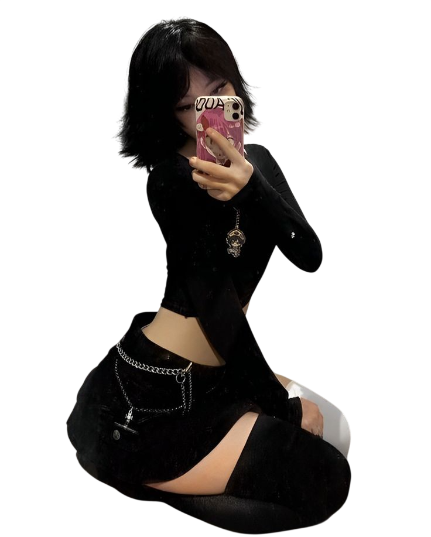

  

  

  
  
  
  

  

<!-- 🖼 ФОТО 1 — справа от приветствия -->

##  Hi there!

-  I'm a **Middle Cross-Platform Mobile Developer**
-  I build apps for Android and iOS from a shared codebase
-  Always enjoying clean code and cool architecture
-  Always open to cool projects & collabs

 

<!-- 🖼 ФОТО 2, 3, 4 — галерея в ряд -->

  
  
  

---

##  Featured Projects & Works

Здесь собраны ключевые коммерческие и рабочие проекты, которые успешно запущены и функционируют:

###  Kotlin Multiplatform
* **Proctoring System SB Test** — система прокторинга для тестирования.
* **CRM System Baiel** — CRM-система для автоматизации бизнес-процессов.

###  Flutter
* **Baytur Issyk-Kyl** — мобильное приложение для курортного отеля и спа-комплекса на Иссык-Куле.
* **Baytur Suusamyr** — приложение для горнолыжного курорта и лечебницы на основе кымыза в Суусамыре.
* **Green bonus** — экологическое приложение для сбора и переработки пластиковых отходов.

###  React Native
* **Sinteza** — комплексный AI-генератор веб-сервиса (видео, изображения, голос).
* **SB Menu** — удобная цифровая экосистема/приложение для ресторанов и общепита.
* **Beiman Wear** — современный интернет-магазин брендовой одежды.

###  JavaScript
* **Asman Tourism** — туристический веб-сайт для путешествий и бронирования.

---

##  Tech stack

  

<!-- 🖼 ФОТО 5, 6, 7 — рядом со статистикой -->

  
  
  

<!-- 🌸 Анимированная надпись внизу по центру -->

  

